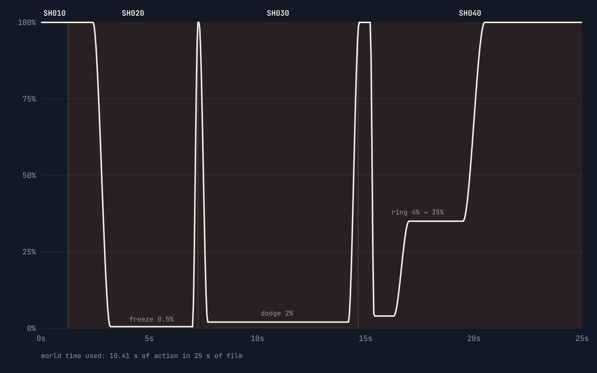
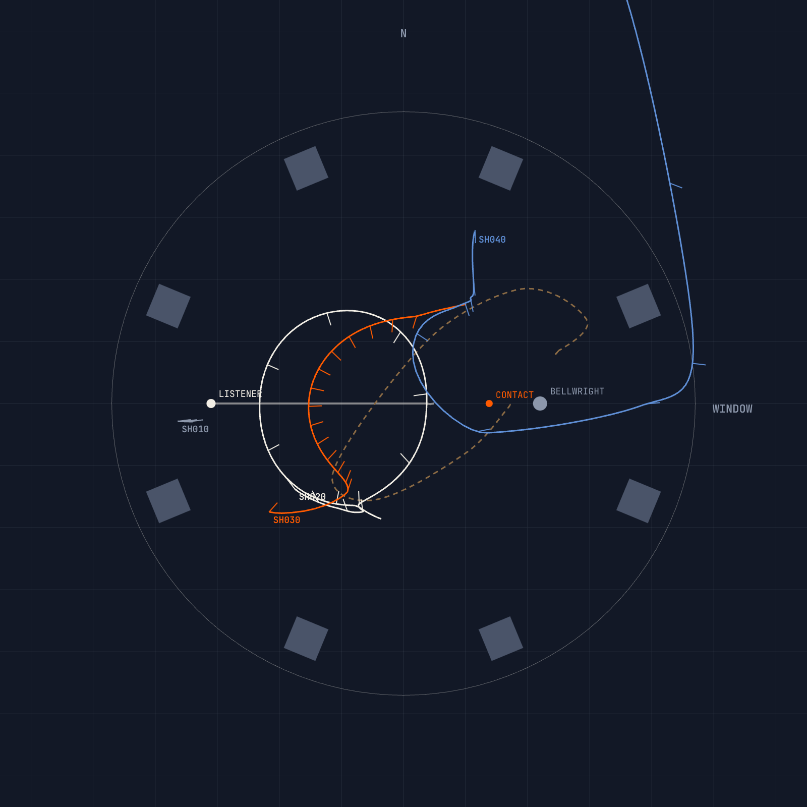

# TEST 01 · THE DROWNED BELFRY · SHOT LIST, CAMERA PATHS, STORYBOARD

25.00 s · 600 frames · 24 fps · 2.39:1 inside a 16:9 frame (burn-ins in the bars) · 4 shots · 3 cuts.

Every table here is generated from `tools/previs/shots.mjs`. If the two disagree, the code is right and this page is stale. Regenerate the stills and the animatic with `node tools/previs/render.mjs`.

---

## 1. Two clocks

The sequence runs on two clocks:
- **Edit time (t):** the film, 25 s long. The camera always moves in edit time.
- **World time (W):** the action. It is 10.4 s of fight stretched across those 25 s of film.

One speed curve maps one to the other, and that curve is all three moves.

| Edit t | Speed | World W | What the curve is doing |
|---|---|---|---|
| 0.00–2.40 | 100% | 0.000–2.400 | standoff, charge, takeoff |
| 2.40–3.20 | 100% → 0.5% | → 2.802 | brake into the apex of the leap |
| 3.20–7.00 | **0.5%** | → 2.821 | **MOVE 01 hold.** Not dead stopped: the rain still breathes |
| 7.00–7.30 | → 100% | → 2.997 | the snap; the bell whips up |
| 7.30–7.70 | 100% → 2% | → 3.201 | brake into the near miss |
| 7.70–14.20 | **2%** | → 3.331 | **MOVE 03 hold** |
| 14.20–15.21 | → 100% | → 4.100 | drop, land, plant, wind up |
| 15.21–15.38 | 100% → 4% | → 4.188 | brake onto the contact |
| 15.38–16.30 | **4%** | → 4.225 | **MOVE 04:** impact frames, the ring is born |
| 16.30–19.50 | → 35% | → 5.236 | ride the ring out through the window |
| 19.50–25.00 | → 100% | → 10.411 | the drowned city, real time |

**Why the freeze holds at 0.5% rather than 0%:** a dead stop reads as a paused video. At 0.5% the bell creeps about 2 cm and the rain beads drift, so the frame stays alive and the threat keeps coming.

## 2. Shot list

| Shot | In – out | Frames | Move | World time | Lens | Action |
|---|---|---|---|---|---|---|
| **SH010** Standoff | 0.00–1.25 s | 30 | — | 0.00–1.25 s | 24 mm | Low over her shoulder. The Bellwright stands against the louvered window light at the end of the line, his bell resting in the flood. She breaks into a sprint. |
| **SH020** The Leap / The Freeze | 1.25–7.25 s | 144 | **01 · 360° freeze** | 1.25–2.95 s | 28–50 mm | Track the charge from her front-right, tilt up through the takeoff, brake into the apex, then one full orbit of the held instant. Snap back to speed. |
| **SH030** The Dodge | 7.25–14.65 s | 178 | **03 · dodge orbit** | 2.95–3.54 s | 22–32 mm | Cut on the snap to a low wide shot as the bell comes up. Time drops to 2% as she lays out flat and the bell crosses her face. The camera swings 178° around the gap. |
| **SH040** The Ring | 14.65–25.00 s | 248 | **04 · impact transition** | 3.54–10.41 s | 16–32 mm | Cut on the landing, from the north side. Real time into the strike, then two impact frames. The ring is born at 4%. The camera rides behind the Bellwright out through the blown louvers and settles on the drowned city as the bell falls into the flood. Title. |

### Cuts
| Cut | Edit t | Why it is hidden |
|---|---|---|
| SH010 → SH020 | 1.25 s | On action, mid-stride. From her back to her front: the lens looked down the line, so a cut to either side is clean. |
| SH020 → SH030 | 7.25 s | On the snap from 0.5% to 100%. The speed change covers the angle change. |
| SH030 → SH040 | 14.65 s | On the landing, a match on action. Both angles are on the north side of the line, where the dodge orbit left the audience. |

## 3. Reveal lists: what each bullet-time beat must show

**MOVE 01 · 360° freeze** (SH020, 3.20–7.00 s). The orbit runs counter-clockwise seen from above (azimuth 88° → −271°):

| Edit t | Camera at | Reveals |
|---|---|---|
| 3.20 | south, low (az 88°, 35 mm) | Geography: her in profile at the apex, fork overhead, the Bellwright small and to the right |
| 4.15 | east (az 2°, 50 mm, 2.3 m) | **Character:** her face under the raised arms, eyes shut, band lifted, rain beads between her and the lens |
| 5.05 | north (az −88°, 40 mm) | **The sound:** the chain glowing signal in the background |
| 5.95 | west, high over her shoulder (az −176°, el 24°) | **The trap:** the bell coiled low behind him. She can't see it. |
| 6.85 | south again | The composition closes; 0.15 s later, the snap |

**MOVE 03 · dodge orbit** (SH030, 7.70–14.20 s), azimuth 108° → 286° around a target 45 cm above her head (the gap):

| Edit t | Camera at | Reveals |
|---|---|---|
| 7.70 | south, body height (az 108°) | She is laid out flat; the bell enters from the far side |
| 10.92 | west, at her head (az 182°, 24 mm, 2.4 m) | **The near miss, 9.2 cm.** Her upside-down face at the bottom of frame, the bronze above, the Bellwright small in the window between them |
| 14.20 | north, higher (az 286°) | The bell has passed; she is already falling to land |

**MOVE 04 · impact transition** (SH040, contact at 15.43 s):

| Edit t | Frame | What happens |
|---|---|---|
| 15.46 | 371 | **Impact frame 1:** signal ground, ink silhouettes of the characters, the fork and the bell |
| 15.50 | 372 | **Impact frame 2:** ink ground, bone silhouettes |
| 15.54–16.30 | — | 4% hold: the strike light floods orange, the ring is born at the tines |
| 16.97 | 407 | The ring reaches the window; the louvers go |
| 17.21 | 413 | The Bellwright passes through the window; the camera follows 5 m behind |
| 18.0 | ~432 | The camera crosses the window plane |
| 22.26 | 534 | The bell hits the flood 42 m below; a water column rises into frame |
| 22.9–25.0 | — | Title over the held final frame |

## 4. Camera path designs

Each key is a turntable rig: a **target** (a world point or a named anchor plus an offset), then **azimuth** (0° = the camera sits east of the target, 90° = south), **elevation**, **distance** and **focal length** on a full-frame gate (36 mm wide, 15.06 mm tall at 2.39). Parameters move on monotone cubic curves in edit time, so they never overshoot a key. Targets blend between keys.

Anchors: `L` is the Listener's hips, `Lchest` and `Lhead` her chest and head, `B` the Bellwright's chest, `contact` the strike point (2.76, 1.32, 0).

#### SH010 · Standoff

| Edit t | World t | Speed | Target | Az | El | Dist | Lens |
|---|---|---|---|---|---|---|---|
| 0.00 s | 0.000 s | 100% | (0.6, 1.6, -0.45) | 172.6° | -2.6° | 7.95 m | 24 mm |
| 1.25 s | 1.250 s | 100% | (0.6, 1.6, -0.45) | 172° | -2.2° | 7.45 m | 24 mm |

#### SH020 · The Leap / The Freeze · MOVE 01 · 360° FREEZE

| Edit t | World t | Speed | Target | Az | El | Dist | Lens |
|---|---|---|---|---|---|---|---|
| 1.25 s | 1.250 s | 100% | L + (0, 0.3, 0) | 52° | 4° | 3.5 m | 32 mm |
| 2.05 s | 2.050 s | 100% | L + (0, 0.35, 0) | 66° | -2° | 3.7 m | 28 mm |
| 2.70 s | 2.666 s | 69% | Lchest + (0, 0.25, 0) | 80° | -10° | 3.6 m | 30 mm |
| 3.20 s | 2.802 s | 0.5% | Lchest + (0, 0.2, 0) | 88° | -6° | 3.3 m | 35 mm |
| 4.15 s | 2.807 s | 0.5% | Lchest + (0, 0.32, 0) | 2° | 0° | 2.3 m | 50 mm |
| 5.05 s | 2.811 s | 0.5% | Lchest + (0, 0.2, 0) | -88° | 8° | 3 m | 40 mm |
| 5.95 s | 2.816 s | 0.5% | Lchest | -176° | 24° | 3.4 m | 28 mm |
| 6.85 s | 2.820 s | 0.5% | Lchest + (0, 0.2, 0) | -266° | -5° | 3.3 m | 35 mm |
| 7.00 s | 2.821 s | 0.5% | Lchest + (0, 0.2, 0) | -271° | -6° | 3.35 m | 35 mm |
| 7.25 s | 2.947 s | 100% | Lchest + (0, 0.1, 0) | -280° | -9° | 3.9 m | 30 mm |

#### SH030 · The Dodge · MOVE 03 · DODGE ORBIT

| Edit t | World t | Speed | Target | Az | El | Dist | Lens |
|---|---|---|---|---|---|---|---|
| 7.25 s | 2.947 s | 100% | Lhead + (0.2, 0.45, 0) | 132° | -20° | 5 m | 22 mm |
| 7.70 s | 3.201 s | 2.0% | Lhead + (0.15, 0.45, 0) | 108° | 2° | 3 m | 32 mm |
| 10.90 s | 3.265 s | 2.0% | Lhead + (0.2, 0.45, 0) | 182° | 4° | 2.4 m | 24 mm |
| 14.20 s | 3.331 s | 2.0% | Lhead + (0.2, 0.35, 0) | 286° | 14° | 3 m | 30 mm |
| 14.65 s | 3.536 s | 97% | L + (0, 0.4, 0) | 296° | 6° | 3.6 m | 30 mm |

#### SH040 · The Ring · MOVE 04 · IMPACT TRANSITION

| Edit t | World t | Speed | Target | Az | El | Dist | Lens |
|---|---|---|---|---|---|---|---|
| 14.65 s | 3.536 s | 97% | (2.5, 1.25, 0) | -92° | 3° | 5.6 m | 28 mm |
| 15.40 s | 4.189 s | 4.0% | contact | -99° | -2° | 3.5 m | 32 mm |
| 16.30 s | 4.225 s | 4.0% | contact + (0.3, 0.1, 0) | -114° | 1° | 3.4 m | 30 mm |
| 17.20 s | 4.431 s | 35% | B + (0, -0.2, 0) | -192° | 3° | 5.4 m | 26 mm |
| 18.10 s | 4.746 s | 35% | B | -186° | 6° | 4.6 m | 26 mm |
| 19.60 s | 5.272 s | 37% | (32, -1, 1) | -148° | 0° | 30 m | 22 mm |
| 21.60 s | 7.011 s | 100% | (28, 0, 3) | -122° | -6° | 50 m | 16 mm |
| 25.00 s | 10.411 s | 100% | (28, 0, 3) | -120° | -6.5° | 52 m | 16 mm |

## 5. Beats

| Beat | Edit time | Frame | World time |
|---|---|---|---|
| She breaks | 0.80 s | 19 | 0.800 s |
| Takeoff | 2.05 s | 49 | 2.050 s |
| Freeze (apex) | 3.10 s | 74 | 2.800 s |
| Snap | 7.00 s | 168 | 2.821 s |
| Near miss | 10.92 s | 262 | 3.265 s |
| Land | 14.66 s | 352 | 3.550 s |
| Contact | 15.43 s | 370 | 4.190 s |
| Louvers go | 16.97 s | 407 | 4.352 s |
| Through the window | 17.21 s | 413 | 4.436 s |
| Bell hits the flood | 22.26 s | 534 | 7.671 s |

## 6. Sound cues (temp pass in the animatic)

Sound runs on world speed too. In this show, quiet is the power.

| Edit t | Cue |
|---|---|
| 0.0–2.4 | Rain bed, room tone, four footfall splashes, takeoff splash |
| 2.4–3.2 | A whoosh as time brakes; **the rain thins to nothing** |
| 3.2–7.0 | **Silence**, then the bell's hum swells (98 Hz with partials): what she hears. Five chain pings, panned right |
| 7.0 | A crack, a sub thump, the rain slams back, the bell rips past |
| 7.7–14.2 | A slow sub swell peaking at the near miss; two heartbeats either side of it |
| 14.66 | Landing splash and thud |
| 15.43 | **The strike:** a noise transient, a sub boom, and a struck bell built from real bell partials (hum, prime, tierce, quint, nominal), layered with the same strike two octaves down for the slow motion |
| 16.97 | The louvers splinter |
| 17.0–19.4 | Wind as the camera leaves the tower |
| 19.6–21.3 | Three distant bells answer from other towers |
| 22.26 | The bell meets the flood far below: a low boom and a wash |
| 22.9–25.0 | The hum returns over the title and cuts dead on the last frame |

For the final mix, record real sources: a struck bronze bell (close and room), chain, rain on stone and water, wood splintering.

## 7. What the previs proves, and what it doesn't

**Proved** (by `tools/previs.test.mjs`, run with `npm test`):
- The freeze lands on the apex of a real-gravity leap. She drifts less than 10 cm while the camera turns 359°.
- The bell's closest pass is **9.2 cm**, at 2% speed, inside the dodge shot, with no contact anywhere in the sequence.
- The fork tip meets the bell within 12 cm of the contact point, and the impact frames fall inside the impact shot.
- The camera and the Bellwright both leave through the window opening, never through stone.
- The lens never enters a pillar, the flood, a city tower, the bell or either character, on any of the 600 frames.
- No cut crosses the line.

**Not proved:**
- The final look.
- The acting.
- Whether an AI video model can hold her identity through a 360° orbit. That is the next test; see `../PIPELINE.md`.
